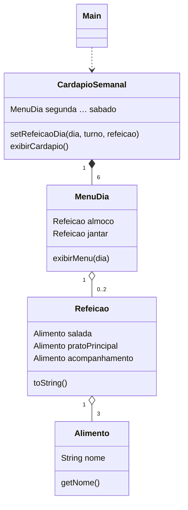

# 05 · Cardápio do RU

Modela o cardápio semanal de um restaurante universitário: alimentos são combinados em refeições
(salada, prato principal e acompanhamento), e cada refeição é associada a um dia e a um turno. O `Main`
é uma demonstração roteirizada, sem entrada do usuário: monta seis alimentos e duas refeições, preenche
o almoço e o jantar de segunda e terça e imprime a semana.



## Limitação conhecida

`Alimento` não sobrescreve `toString`, então `Refeicao.toString()` imprime a referência do objeto
(ex.: `RU.Alimento@1b6d3586`) em vez do nome do alimento.

## Como executar

```bash
javac -encoding UTF-8 -d out RU/*.java
java -cp out RU.Main
```
