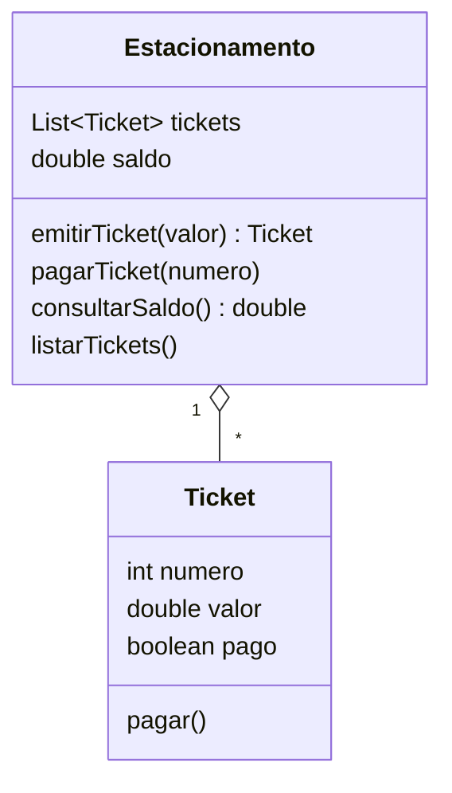

# 06 · Máquina de estacionamento

Modela a emissão e o pagamento de tickets. O `Main` é uma demonstração roteirizada, sem menu: emite
dois tickets (R$ 10 e R$ 15), lista, paga o primeiro e mostra o saldo arrecadado.



- O número do ticket é sequencial (`tickets.size() + 1`).
- `pagarTicket` só soma ao saldo se o ticket ainda não estiver pago, então pagar duas vezes não
  duplica a arrecadação.

## Como executar

```bash
javac -encoding UTF-8 -d out Estacionamento/*.java
java -cp out Estacionamento.Main
```
