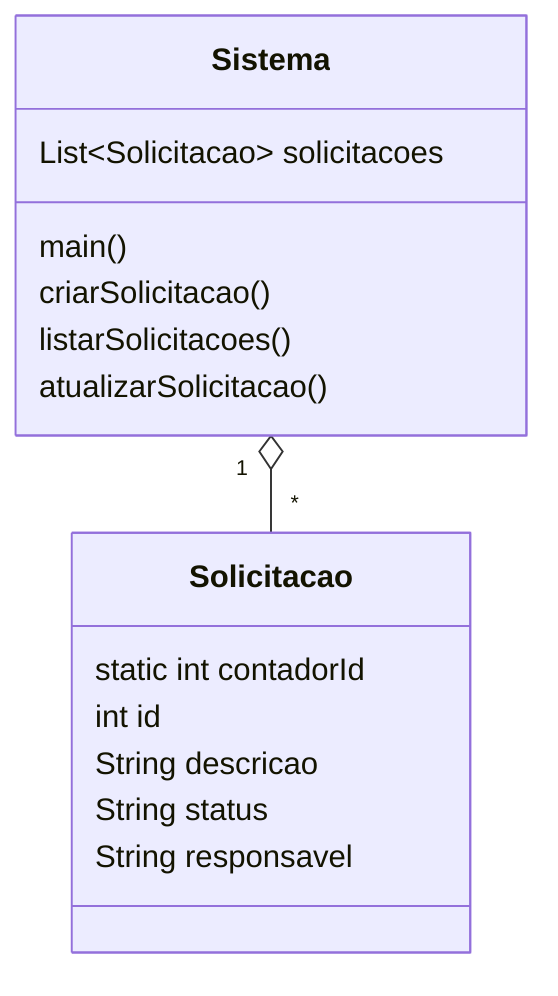

# 07 · Gerenciamento de solicitações internas

CRUD de console para pedidos internos: criar, listar e atualizar (descrição, status e responsável).
Cada solicitação recebe um id de um contador estático e começa como "Pendente" e "Não atribuído".



Usa o `switch` com `->` (Java 14+). O status é texto livre digitado pelo usuário.

## Como executar

```bash
javac -encoding UTF-8 -d out *.java
java -cp out Sistema
```
